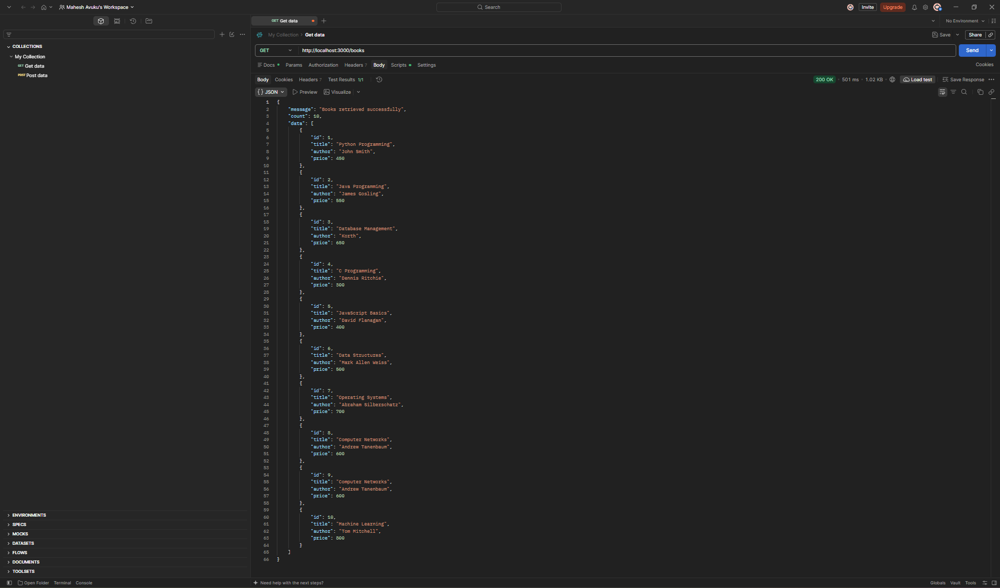
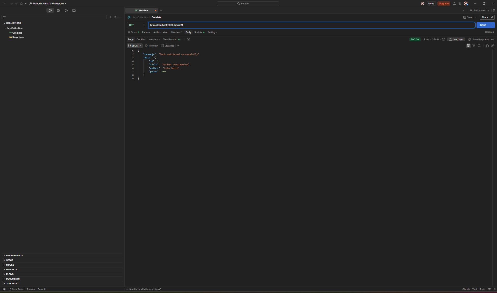
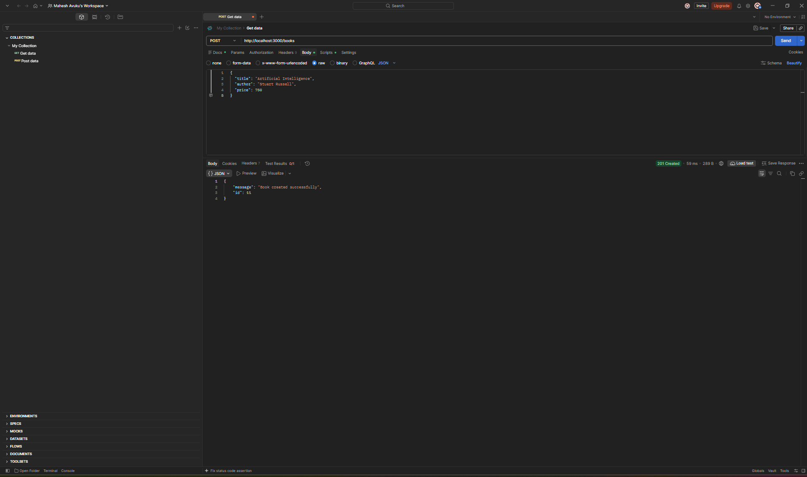
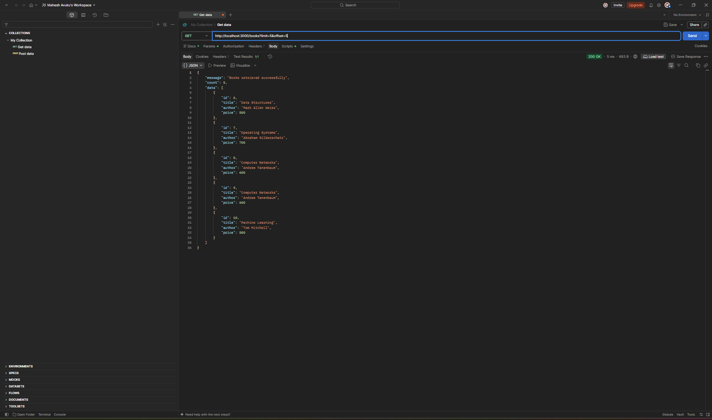
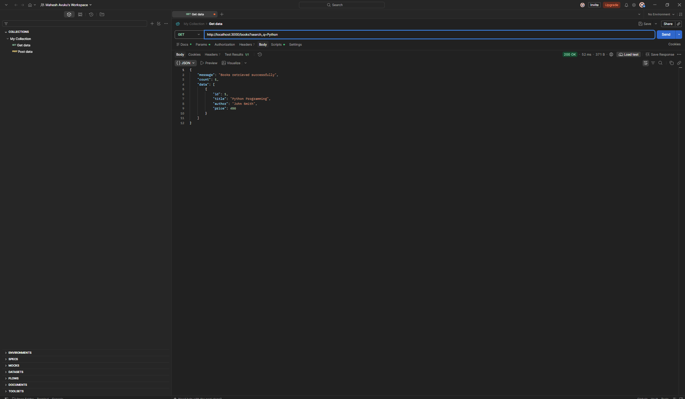
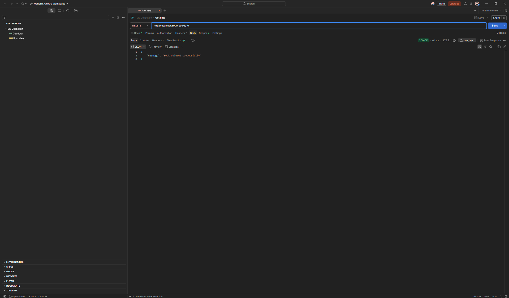
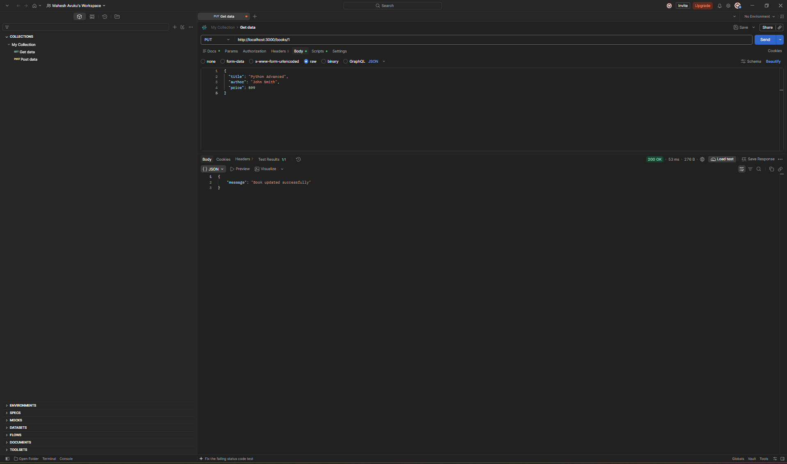
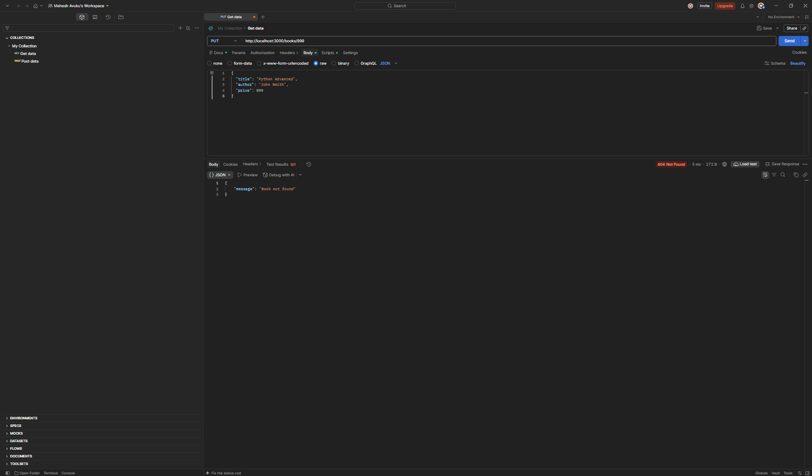

# BDF Lab 3 – REST API Development

## Project Description
This project demonstrates REST API development using Node.js, Express.js, and SQLite. It supports CRUD operations, search, sorting, pagination, validation, and error handling.

## Technologies Used
- Node.js
- Express.js
- SQLite
- Postman
- Git and GitHub

## Features
- Get all books
- Get a book by ID
- Add a new book
- Update book details
- Delete a book
- Search books by title
- Sort books in ascending and descending order
- Pagination using limit and offset
- Filter books by price range
- Request validation and error handling

## API Endpoints

| Method | Endpoint | Description |
|---|---|---|
| GET | `/books` | Get all books |
| GET | `/books/:id` | Get book by ID |
| POST | `/books` | Add a book |
| PUT | `/books/:id` | Update a book |
| DELETE | `/books/:id` | Delete a book |

## Query Parameters
- `search_q` – Search by title
- `order_by` – Sort by a column
- `order` – ASC or DESC
- `limit` – Number of records
- `offset` – Skip records
- `min_price` – Minimum price
- `max_price` – Maximum price

## Installation

1. Clone the repository.
2. Install dependencies:

   `npm install`

3. Start the server:

   `npm run dev`

4. Open Postman and test:

   `http://localhost:3000/books`

## Testing
API endpoints were tested using Postman, including successful requests and failure cases.

## Author
BDF Lab 3 – Backend Development Fundamentals
## 📸 Postman API Testing Screenshots

### 1. GET All Books

### 2. GET Book by ID

### 3. POST Add New Book

### 4. Sorting Books in Ascending Order

### 5. Pagination using Offset

### 6. Search Books

### 7. GET Book Not Found

### 8. DELETE Book

### 9. DELETE Book Not Found

### 10. PUT Update Book

### 11. PUT Book Not Found
